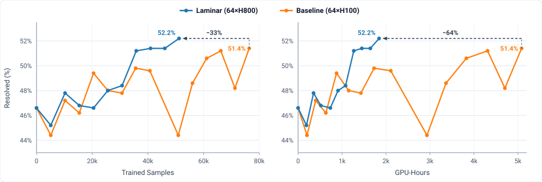
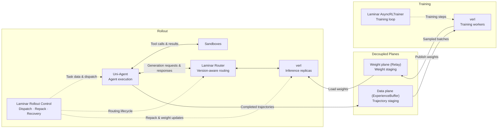

<!-- markdownlint-disable MD033 MD041 -->
<p align="center">
  <picture>
    <source media="(prefers-color-scheme: dark)" srcset="assets/logo-dark.svg">
    
  </picture>
</p>

## About

Laminar is a scalable reinforcement learning (RL) post-training framework for large language models (LLMs) and long-horizon agents, built on [verl](https://github.com/verl-project/verl) and [Uni-Agent](https://github.com/verl-project/uni-agent).

Laminar is the open-source implementation of [Laminar: A Scalable Asynchronous RL Post-Training Framework](https://doi.org/10.1145/3767295.3803580) (EuroSys '26).

Laminar scales RL post-training to large clusters through a decoupled, asynchronous, and fault-tolerant design:

- **Fully Decoupled Training and Rollout**: Decouples rollout and training into independent loops through dedicated data and weight planes without synchronous step barriers.
  - **Data plane (`ExperienceBuffer`)**: Buffers completed trajectories from rollout for `AsyncRLTrainer` to sample.
  - **Weight plane (`Relay`)**: Stages published weights from the trainer for inference replicas to pull on demand.
- **Trajectory-Level Asynchrony**: Generates and consumes individual trajectories independently at their own pace.
  - **Version-mixed partial rollout**: Interrupts in-flight generations on weight sync and continues with newer weights (see paper [Figure 3(d)](https://doi.org/10.1145/3767295.3803580)).
  - **Version-consistent rollout**: Keeps each trajectory on a single model version without mid-trajectory re-prefill (see paper [Figure 3(e)](https://doi.org/10.1145/3767295.3803580)).
  - **Dynamic repack**: Monitors replica KV-cache utilization and consolidates remaining long-tail trajectories onto fewer replicas within the same version group, freeing drained replicas to pull the latest weights immediately (see paper [Figure 8](https://doi.org/10.1145/3767295.3803580)).
  - **Concurrent multi-checkpoint evaluation (`laminar.eval`)**: Applies version-pinned routing and tail repacking across checkpoints for bubble-free offline batch and online streaming evaluation (see [docs/evaluation.md](docs/evaluation.md)).
- **Fault-Tolerant Execution**: Prevents single-replica failures from stalling cluster-wide progress.
  - **Inference engines**: Recover failed replicas from `Relay` (training) or checkpoint storage (evaluation) while preserving in-flight trajectory prefixes.
  - **Trainer engine**: Resumes from the latest checkpoint (WIP: asynchronous per-step checkpoint).

In SWE agent training (`Qwen3-Coder-30B-A3B-Instruct` on SWE-rebench, evaluated on SWE-bench Verified on 64×H800):

- Improves resolve rate from 46.6% to **52.2%**, surpassing the baseline peak (51.4%).
- Uses **33% fewer** trained samples and **64% fewer** GPU-hours to exceed the baseline peak.

See the [SWE recipe](recipes/swe/README.md#benchmark-results) for the full benchmark setup and results.



## Architecture



Solid arrows show data and weight flow; dashed arrows show control and dispatch.

- **Rollout–Training Decoupling**:
  - **Data plane (`ExperienceBuffer`)**: Decouples trajectory production from batch sampling so rollout continues without waiting for optimizer steps.
  - **Weight plane (`Relay`)**: Decouples weight publication (over UCX or NCCL) from replica updates so training continues without waiting for rollout drains.
- **Ecosystem Boundaries**:
  - **Laminar**: Data plane (`ExperienceBuffer`), weight plane (`Relay`), rollout/training controllers, version-aware routing, dynamic repack, and fault recovery.
  - **[verl](https://github.com/verl-project/verl)**: Distributed model training (Megatron-LM, FSDP2) and inference (vLLM) backends.
  - **[Uni-Agent](https://github.com/verl-project/uni-agent)**: Agent execution, tool calling, and sandbox integration.

## Getting Started

<!-- TODO: switch verl and uni-agent Git sources in pyproject.toml back to verl-project/{verl,uni-agent} once upstream PRs are merged. -->
Laminar manages Python, CUDA, wheel indexes, and pinned Git dependencies with [`uv`](https://docs.astral.sh/uv/) (see [pyproject.toml](pyproject.toml) and [uv.lock](uv.lock)).

Select the optional extras matching your workload:

- **Inference backends**:
  - `--extra vllm`: vLLM rollout and evaluation backend.
- **Training backends**:
  - `--extra megatron`: Megatron-LM training backend.
  - `--extra fsdp`: FSDP2 training backend.
- **Weight plane transport**:
  - `--extra ucx` (recommended): UCX transport for `Relay`.
  - NCCL fallback (`relay.backend=nccl`): Uses bundled NCCL without extra packages, with reduced fault tolerance due to communicator groups.
- **Task dependencies**:
  - `--extra swe`: SWE task scoring dependencies.

> **Cluster note**: Prepare the environment at the same absolute path on every Ray node.

**Example setup (Megatron + vLLM + UCX + SWE):**

```bash
git clone https://github.com/verl-project/laminar.git
cd laminar
uv run --no-project scripts/sync_dependency_config.py --check
uv sync --locked --extra megatron --extra vllm --extra ucx --extra swe
```

Once the environment is ready, see [Recipes](#recipes) to launch training and evaluation experiments.

## Recipes

- **[SWE](recipes/swe/README.md)**: `Qwen3-Coder-30B-A3B-Instruct` on SWE-rebench and SWE-bench Verified (46.6% → **52.2%** on 64×H800).

## Contributing

See [CONTRIBUTING.md](CONTRIBUTING.md) for development and testing guidelines.

## Security

See [SECURITY.md](SECURITY.md) for reporting security issues privately.

## Citation

If you use Laminar in your research, please cite our [paper](https://doi.org/10.1145/3767295.3803580):

```bibtex
@inproceedings{shengtong2026laminar,
  title={Laminar: A Scalable Asynchronous RL Post-Training Framework},
  author={Sheng, Guangming and Tong, Yuxuan and Wan, Borui and Zhang, Wang and Jia, Chaobo and Wu, Xibin and Wu, Yuqi and Li, Xiang and Zhang, Chi and Peng, Yanghua and Lin, Haibin and Liu, Xin and Wu, Chuan},
  booktitle={Proceedings of the 21st European Conference on Computer Systems (EuroSys '26)},
  pages={400--422},
  year={2026},
  publisher={Association for Computing Machinery},
  doi={10.1145/3767295.3803580},
  url={https://doi.org/10.1145/3767295.3803580}
}
```

## License

[Apache-2.0](LICENSE).
