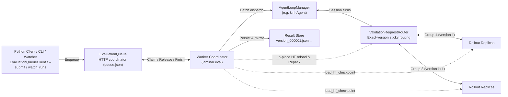

# Evaluation (`laminar.eval`)

`python -m laminar.eval` runs standalone checkpoint evaluation over resident
rollout replicas without instantiating trainer, optimizer, or `Relay` actors.

## Features

`laminar.eval` is designed for **efficient multi-checkpoint concurrent evaluation**:

- **Long-Tail Bubble Mitigation:**
  - **Concurrent Replica Subsets:** evaluate multiple checkpoints—whether across consecutive steps of a single training run or across different experiments—simultaneously on disjoint replica subsets (or across attached workers) with exact-version sticky routing (`ValidationRequestRouter`).
  - **Cross-Checkpoint Repack:** consolidate tail-stage sessions onto fewer replicas (`validation.repack`) when another checkpoint is waiting, immediately releasing drained replicas from the initial pool to load and evaluate the next queued checkpoint while the previous tail finishes, and recombining finished subsets once both complete.
- **Resident Replicas & In-Place Reload:**
  - **Direct HF Initialization:** load Hugging Face checkpoints (or trainer `global_step_*` directories) directly into resident rollout replicas without allocating trainer, optimizer, or `Relay` resources.
  - **In-Place Weight Reload:** switch checkpoints in place via `LLMServerController.load_hf_checkpoint` without restarting Ray actors or inference engines.
  - **Fault-Tolerant Replica Recovery:** automatically fence, restart, and reload failed rollout replicas at their exact assigned checkpoint version while preserving already generated tokens for interrupted turns.
- **Unified Persistent Queue Service:**
  - **Single- or Multi-Run Companion Evaluation:** watch one or more active training run directories (`validation.queue.watch_runs` or `validation.queue.watch_dir`) to auto-discover completed `global_step_*` checkpoints, skip already evaluated checkpoints, and mirror finished `version_*.json` results back into each originating run's `validation/` directory.
  - **On-Demand Submission:** pre-enqueue checkpoints at startup (`validation.checkpoints`), or submit additional checkpoints on the fly via Python Client (`EvaluationQueueClient`) or CLI—for example, to evaluate a previously skipped step or compare checkpoints from another run on the same resident service.
  - **Elastic Worker Scaling:** attach or drain additional independent GPU worker jobs (`validation.queue.endpoint`) on the fly—for example, temporarily adding idle or spot GPU pools to clear a backlog of queued checkpoints.

## Architecture & Workflow



1. **Task Admission (`EvaluationQueue`, `CheckpointRunWatcher` & `CheckpointDirectoryWatcher`):**
   - Checkpoints are admitted into a durable HTTP queue (`<result_dir>/queue/queue.json`) from `validation.checkpoints` at startup, from watched training directories (`validation.queue.watch_runs` / `validation.queue.watch_dir`), or dynamically via Python Client / CLI.
   - When `validation.queue.watch_runs` is configured, `CheckpointRunWatcher` scans one or more training run roots for committed `global_step_*` HF exports (Megatron `actor/model/huggingface` or FSDP `actor/huggingface`), syncs bootstrap model/tokenizer metadata (backing up original export metadata under `.megatron_export_meta/`), skips checkpoints already queued or recorded in `<run_dir>/validation/` (or `completed_versions/`), and mirrors completed results back into each run's `validation/` directory.
2. **Exact-Version Routing (`ValidationRequestRouter`):**
   - Each worker initializes its replica pool on its first claimed checkpoint, assigns monotonically increasing evaluation `version` numbers (`1, 2, ...`) to claimed tasks, and pins all session turns of each checkpoint to its exact `weight_version`.
3. **Batched Rollout, Long-Tail Repack & Replica Recovery:**
   - Prompts are dispatched in waves of `validation.batch_size`.
   - Once the final batch of a checkpoint is in flight across $\ge 2$ replicas and another checkpoint is waiting in the queue, `plan_validation_repack` periodically migrates active session routes from lightly loaded source replicas (`kv_cache_usage <= source_max_kv_cache_usage`) to destination replicas of the same version (`kv_cache_usage <= destination_max_kv_cache_usage`), aborting and resuming in-flight turns from already generated tokens.
   - Drained source replicas are released via `/release-replicas` and immediately claim and reload the next queued checkpoint while the remaining replica subset finishes the old checkpoint's tail; finished subsets from the same original group are automatically recombined when idle.
   - If a rollout replica crashes during reload or rollout, `recover_dead_server` fences the replica in `ValidationRequestRouter`, restarts it onto its assigned checkpoint and exact version, and resumes interrupted turns from their generated token prefixes.
4. **In-Place Reload & Result Finalization:**
   - When a replica group (or repacked subset) claims its next checkpoint, `ValidationRequestRouter` fences those replicas from routing while `load_hf_checkpoint` reloads the new Hugging Face weights in place.
   - Completed prompt trajectories and rewards are aggregated, verified, and atomically persisted to `<result_dir>/version_<version:06d>.json` (and mirrored to `<run_dir>/validation/` when `watch_runs` or `source.result_dir` is set) before acknowledging `/finish` to the queue.

## Usage

### 1. Start the Evaluation Service

Refer to [`src/laminar/eval/config/validation_base.yaml`](../src/laminar/eval/config/validation_base.yaml) for all `validation.*`, `rollout_router.*`, and default `actor_rollout_ref.*` configuration options.

`python -m laminar.eval` starts the persistent HTTP queue service (writing its URL to `<result_dir>/queue/endpoint.txt`) and runs worker control in the same driver, so a loopback endpoint remains local. Inference replicas use the Ray cluster's `rollout.nnodes × rollout.n_gpus_per_node` GPUs. Embedded workers receive a fresh submission identity unless `validation.queue.worker_id` is supplied:

```bash
# Companion mode watching one or more training runs (or use validation.queue.watch_dir for a single checkpoint dir)
python -m laminar.eval \
  actor_rollout_ref.model.path=/shared/models/Base-Model \
  validation.data_path=/shared/data/eval.parquet \
  validation.result_dir=/shared/outputs/eval-service \
  'validation.persistent_roots=[/shared/outputs]' \
  'validation.queue.watch_runs=[/shared/outputs/swe-run-001,/shared/outputs/swe-run-002]' \
  validation.queue.server_host=0.0.0.0 \
  validation.queue.server_port=9000 \
  actor_rollout_ref.rollout.nnodes=1 \
  actor_rollout_ref.rollout.n_gpus_per_node=8 \
  actor_rollout_ref.rollout.tensor_model_parallel_size=4 \
  actor_rollout_ref.rollout.agent.agent_loop_manager_class=uni_agent.framework.entry.AgentFrameworkRolloutAdapter
```

- **Multi-run / single-run companion watching:**
  - `validation.queue.watch_runs=[/path/to/run_a,/path/to/run_b]`: watches multiple training run roots, syncs bootstrap model/tokenizer metadata onto new `global_step_*` HF exports, optionally evaluates the base model once (`validation.queue.watch_include_base=true`), and mirrors each finished result back to `<run_dir>/validation/version_*.json`.
  - `validation.queue.watch_dir=/path/to/checkpoints`: watches a single checkpoint directory directly (polling `latest_checkpointed_iteration.txt`).
- **Offline / on-demand mode:** omit `watch_runs` / `watch_dir` and optionally pre-enqueue initial checkpoints via `'validation.checkpoints=[/shared/checkpoints/global_step_400]'`.
- **Elastic multi-worker scaling (optional):** to attach additional independent GPU worker jobs (e.g., across separate Ray jobs or elastic spot pools) to the running queue, launch `python -m laminar.eval` with `validation.queue.endpoint=http://<service-host>:9000`, a unique `validation.queue.worker_id`, and a fresh `validation.result_dir` (or set `validation.queue.coordinator_only=true` on the primary process if it should run on a CPU-only node without local GPUs).

### 2. Control a Running Service (Python Client & CLI)

The Python Client (`EvaluationQueueClient`, recommended) and CLI (`python -m laminar.eval`) map 1-to-1 and share the same endpoint resolution order (`resolve_queue_endpoint`):
1. Explicit `endpoint` (`EvaluationQueueClient(endpoint=...)` or `--endpoint http://<host>:<port>`)
2. `endpoint.txt` inside `state_dir` or `<result_dir>/queue/endpoint.txt` (when `server_host=0.0.0.0`, `endpoint.txt` records `http://127.0.0.1:<port>` for same-host clients; pass `endpoint` explicitly from remote hosts, or set `validation.queue.server_host=<service-ip>` so `endpoint.txt` records the routable IP)
3. Default `http://127.0.0.1:9000`

#### Python Client (Default)

```python
from laminar.eval import EvaluationQueueClient

# Connect via result_dir (or state_dir=..., endpoint="http://127.0.0.1:9000", timeout=30.0)
client = EvaluationQueueClient(result_dir="/shared/outputs/eval-run-001")

# Submit one or more checkpoints (accepts global_step_* or Hugging Face model dirs)
tasks = client.submit(
    "/shared/checkpoints/global_step_440",
    "/shared/checkpoints/global_step_480",
    # Optional: source={...}, resume_results=[...], resume_protocol={...}
)

# Query full queue state or a single task_id
queue_state = client.status()
task_state = client.status(tasks[0]["task_id"])

# Drain the entire queue, or drain a single worker
client.drain()
client.drain(worker="worker-01")

# Requeue a finished task with audited repair evidence
client.requeue(
    tasks[0]["task_id"],
    previous_sha256="<result_sha256>",
    review={"verdict": "FAIL", "artifact": "/shared/outputs/audit.json", "sha256": "..."},
    # Optional: resume_results=[...], resume_protocol={...}
)
```

#### CLI (`python -m laminar.eval`)

```bash
# Submit one or more checkpoints (--source, --resume-results, --resume-protocol also supported)
python -m laminar.eval --result-dir /shared/outputs/eval-run-001 \
  --submit /shared/checkpoints/global_step_440 /shared/checkpoints/global_step_480

# Query full queue state or a single task_id
python -m laminar.eval --result-dir /shared/outputs/eval-run-001 --status
python -m laminar.eval --result-dir /shared/outputs/eval-run-001 --status <task_id>

# Drain the entire queue, or drain a single worker
python -m laminar.eval --result-dir /shared/outputs/eval-run-001 --drain
python -m laminar.eval --result-dir /shared/outputs/eval-run-001 --drain --worker worker-01

# Requeue a finished task with audited repair evidence
python -m laminar.eval --result-dir /shared/outputs/eval-run-001 \
  --requeue <task_id> \
  --previous-sha256 <result_sha256> \
  --review '{"verdict":"FAIL","artifact":"/shared/outputs/audit.json","sha256":"..."}'
```

## Outputs

All evaluation artifacts are written under `validation.result_dir` (which must reside under `validation.persistent_roots`):

- **`<result_dir>/version_000001.json`, `version_000002.json`, ...**: Per-checkpoint evaluation records and `val-core/*` / `val-aux/*` metrics (when `watch_runs` or `source.result_dir` is used, each completed record is also mirrored into the originating run's `<run_dir>/validation/version_*.json`); refer to [`_run_checkpoints` / `_summarize_scores`](../src/laminar/eval/main.py), [`mirror_run_validation_result`](../src/laminar/eval/worker.py), and [`summarize_evaluation` / `reward_evidence`](../src/laminar/eval/metrics.py) for the schema and scoring validity rules.
- **`<result_dir>/queue/queue.json` & `endpoint.txt`**: Durable queue state, task ownership, and active HTTP endpoint; refer to [`EvaluationQueue`](../src/laminar/eval/server.py).
- **`<result_dir>/efficiency/efficiency_<timestamp_ns>.json`**: Periodic non-destructive runtime efficiency snapshots; refer to [`_EfficiencySnapshots.capture`](../src/laminar/eval/main.py).
