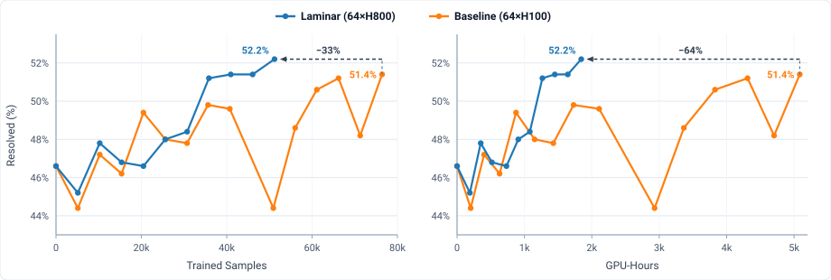

# SWE agent training

This recipe trains `Qwen/Qwen3-Coder-30B-A3B-Instruct` on SWE-rebench and
evaluates checkpoints on SWE-bench Verified on **NVIDIA H800 or H20** GPUs.

## Benchmark results

- **Setup:**
  - **Model:** `Qwen/Qwen3-Coder-30B-A3B-Instruct`
  - **Training:** SWE-rebench, GRPO + GSPO (`n=8` rollouts/prompt, `128K` response, `200` max turns)
  - **Baseline:** Uni-Agent [ReAct RL recipe](https://github.com/verl-project/uni-agent/blob/main/docs/source/quickstart/rl-training.md#case-1-react-agent-rl) ([`train_qwen3_moe.sh`](https://github.com/verl-project/uni-agent/blob/main/examples/quickstart/training/train_qwen3_moe.sh))
  - **Evaluation:** SWE-bench Verified (500 instances, greedy `n=1`; baseline checkpoints re-evaluated under the same [`eval.sh`](eval.sh) protocol)
  - **Trajectory version:** Baseline uses [version-mixed partial rollout](../../README.md#about), whereas Laminar keeps each trajectory on a single consistent weight version.

| Run                                | Cluster | Trajectory version | Global batch size | Mini batch size | Weight sync interval | Trained samples  | GPU-hours         | Resolved (%)               |
| ---------------------------------- | ------- | ------------------ | ----------------: | --------------: | -------------------: | ---------------: | ----------------: | -------------------------: |
| **Base**                           | —       | —                  | —                 | —               | —                    | 0                | —                 | 46.6% (233/500)            |
| **Baseline** (Step 100)            | 64×H100 | Mixed              | 512               | 128             | 1 step (512 traj.)   | 50.9k            | 2,932             | 44.4% (222/500)            |
| **Baseline** (Step 150, peak)      | 64×H100 | Mixed              | 512               | 128             | 1 step (512 traj.)   | 76.4k            | 5,085             | 51.4% (257/500)            |
| **Laminar** (Step 320, match peak) | 64×H800 | Consistent         | 128               | 128             | 4 steps (512 traj.)  | 41.0k (−46%)     | 1,450 (−71%)      | 51.4% (257/500)            |
| **Laminar** (Step 400, peak)       | 64×H800 | Consistent         | 128               | 128             | 4 steps (512 traj.)  | **51.2k (−33%)** | **1,843 (−64%)**  | **52.2% (261/500, +5.6%)** |



## Recommended GPU allocation

- **Cluster:** 8 nodes × 8 GPUs (64 GPUs total)
- **Trainer:** Megatron `TP1/PP1/CP8/EP8`
- **Rollout:** vLLM `TP2` (14 concurrent sessions / replica)

| GPU | Trainer : Rollout | Trainer GPUs | Rollout GPUs | Max concurrent sessions | Launch overrides |
| --- | --- | ---: | ---: | ---: | --- |
| **H800** | **1 : 3** | 16 (2 nodes, `DP2`) | 48 (6 nodes, 24 replicas) | 336 | Default |
| **H20** | **1 : 1** | 32 (4 nodes, `DP4`) | 32 (4 nodes, 16 replicas) | 224 | `bash recipes/swe/train.sh trainer.nnodes=4 actor_rollout_ref.rollout.nnodes=4 relay.num_cpus=4` |

## File layout

- [`train.sh`](train.sh): training launch script (`python -m laminar.train`)
- [`eval.sh`](eval.sh): evaluation service and CLI wrapper (`python -m laminar.eval`; see [docs/evaluation.md](../../docs/evaluation.md))
- [`task_config.yaml`](task_config.yaml): Uni-Agent ReAct task configuration (aligned with [Quickstart SWE config](https://github.com/verl-project/uni-agent/blob/main/examples/quickstart/training/task_config_react.yaml))

## Prerequisites

- **Cluster:**
  - 8 nodes × 8 GPUs (64 GPUs total)
  - Shared environment and checkout path on all nodes (see [Getting Started](../../README.md#getting-started); the commands below use the default `--extra megatron --extra vllm --extra ucx` extras as an example)
  - Shared persistent storage (`PERSISTENT_OUTPUT_ROOT`)
  - Configured Relay transport variables (e.g., `UCXX_IFNAME`, `UCX_TLS` for UCX)
- **Sandboxes (Uni-Agent integration):**
  - **Default config:** [`task_config.yaml`](task_config.yaml)
    - Aligned with Uni-Agent's [Quickstart SWE config](https://github.com/verl-project/uni-agent/blob/main/examples/quickstart/training/task_config_react.yaml) (`provider: vefaas`, `runtime_timeout: 7200`), which automatically maps `swebench/*` and `swerebench/*` to Volcengine public container registries without requiring `image_map`.
  - **Custom backends & mirrors:**
    - Set `sandbox.provider` in [`task_config.yaml`](task_config.yaml) to match your backend (`vefaas`, `modal`, `docker`, `openyuanrong`, or custom plugins via `UNI_AGENT_SANDBOX_PLUGINS`)
    - Optionally add `sandbox.image_map` rules when pulling from a self-hosted registry mirror.
  - **Provider setup:** See the Uni-Agent [Launch a Sandbox](https://github.com/verl-project/uni-agent/blob/main/docs/source/quickstart/launch-sandbox.md) and [Sandbox (`image_map`)](https://github.com/verl-project/uni-agent/blob/main/docs/source/concepts/sandbox.md#image_map) guides for credentials and SDK installation.

**1. Download model weights:**

```bash
export MODEL_PATH=/shared/models/Qwen3-Coder-30B-A3B-Instruct
# Pin a specific Hugging Face revision for reproducibility
export MODEL_REVISION=b2cff646eb4bb1d68355c01b18ae02e7cf42d120
uv run --locked --extra megatron --extra vllm --extra ucx --extra swe python - <<'PY'
import os
from huggingface_hub import snapshot_download

snapshot_download(
    repo_id="Qwen/Qwen3-Coder-30B-A3B-Instruct",
    revision=os.environ["MODEL_REVISION"],
    local_dir=os.environ["MODEL_PATH"],
)
PY
```

**2. Prepare SWE-rebench and SWE-bench Verified parquets:**

```bash
export DATA_DIR=/shared/data/swe
uv run --locked --extra megatron --extra vllm --extra ucx --extra swe \
  python -m uni_agent.tasks.swe_rebench.preprocess --local-save-dir "$DATA_DIR"
uv run --locked --extra megatron --extra vllm --extra ucx --extra swe \
  python -m uni_agent.tasks.swe_bench.preprocess --local-save-dir "$DATA_DIR"
```

## Train

```bash
export UV_PROJECT="$PWD"
export UV_PROJECT_ENVIRONMENT="$PWD/.venv"
export MODEL_PATH=/shared/models/Qwen3-Coder-30B-A3B-Instruct
export TRAIN_FILE="$DATA_DIR/swe_rebench_filtered.parquet"
export RAY_DATA_HOME=/shared/outputs/swe-run-001
export PERSISTENT_OUTPUT_ROOT=/shared/outputs
export RAY_ADDRESS=auto

uv run --locked --extra megatron --extra vllm --extra ucx --extra swe \
  bash recipes/swe/train.sh
```

- **Smoke test:** Run a 4-step check first with `bash recipes/swe/train.sh trainer.total_training_steps=4 trainer.save_freq=4` in a fresh `RAY_DATA_HOME` to verify optimizer steps, Relay weight publication, and checkpoint saving.

## Evaluate checkpoints

See [docs/evaluation.md](../../docs/evaluation.md) for the evaluation mechanism, configuration options, and Python Client / CLI details.

### 1. Companion evaluation (alongside one or more training runs)

```bash
export UV_PROJECT="$PWD"
export UV_PROJECT_ENVIRONMENT="$PWD/.venv"
export MODEL_PATH=/shared/models/Qwen3-Coder-30B-A3B-Instruct
export VALIDATION_FILE="$DATA_DIR/swe_bench_verified.parquet"
export VALIDATION_OUTPUT_DIR=/shared/outputs/swe-eval-001
export PERSISTENT_OUTPUT_ROOT=/shared/outputs
# Watch a single checkpoint dir (WATCH_DIR) or multiple training run roots (WATCH_RUNS="[run1,run2]")
export WATCH_RUNS="[/shared/outputs/swe-run-001,/shared/outputs/swe-run-002]"
export RAY_ADDRESS=auto

uv run --locked --extra vllm --extra swe \
  bash recipes/swe/eval.sh
```

### 2. Offline submission

```bash
export UV_PROJECT="$PWD"
export UV_PROJECT_ENVIRONMENT="$PWD/.venv"
export CHECKPOINT_PATH=/shared/checkpoints/global_step_400/actor/model/huggingface
export VALIDATION_FILE="$DATA_DIR/swe_bench_verified.parquet"
export VALIDATION_OUTPUT_DIR=/shared/outputs/swe-eval-001
export PERSISTENT_OUTPUT_ROOT=/shared/outputs
export RAY_ADDRESS=auto

uv run --locked --extra vllm --extra swe \
  bash recipes/swe/eval.sh
```

Control the running service via Python Client (or CLI via `bash recipes/swe/eval.sh --submit / --status / --drain`):

```python
from laminar.eval import EvaluationQueueClient

client = EvaluationQueueClient(result_dir="/shared/outputs/swe-eval-001")
client.submit("/shared/checkpoints/global_step_440", "/shared/checkpoints/global_step_480")
print(client.status())
client.drain()
```
